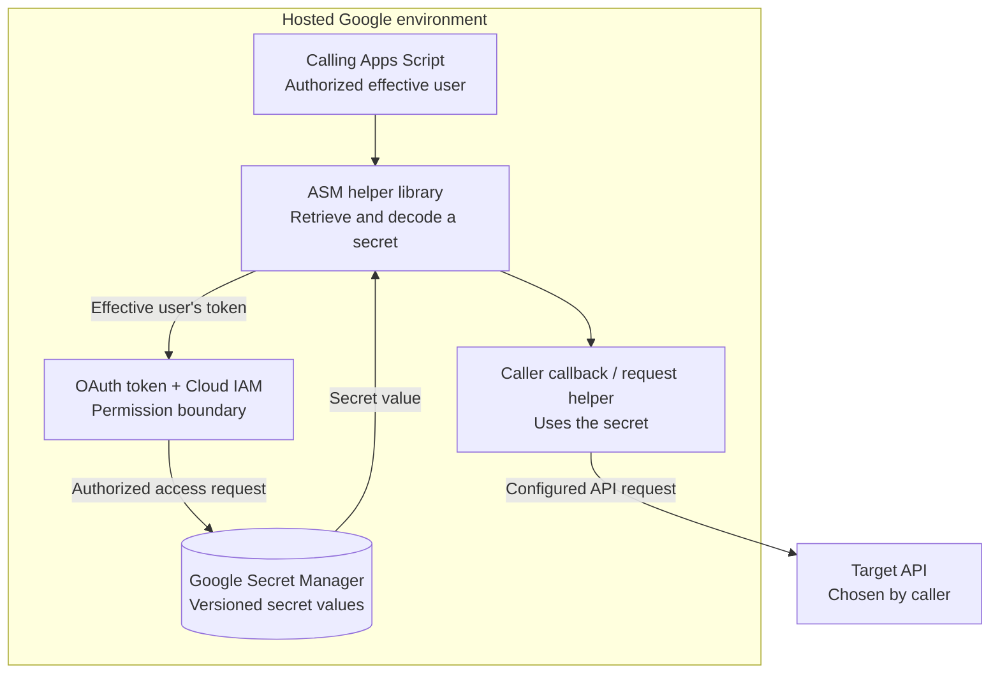

# Apps Script Secrets Manager architecture

A helper library intended to retrieve Google Secret Manager values for Google Apps Script workflows.

This is a source-level integration overview, not a claim that a deployed library is healthy or secure. The committed standalone source has unresolved request-construction issues.

[PNG image](overview.png) · [Editable Mermaid source](overview.mmd)

Arrows show requests or data movement; replies return along the same route. Boxes grouped as local or hosted show where work runs. Authentication boundaries are labeled where present.

## Component roles

| Component | Role | Learn more |
| --- | --- | --- |
| Calling Apps Script | Supplies the requested secret and runs under its effective user. | [Reference](https://developers.google.com/apps-script) |
| ASM library | Fetches and decodes the payload, then passes it to a callback or request helper. | [Reference](../../Code.ts) |
| OAuth and IAM | Google authorization and secret permissions determine access. The library is not a separate identity service. | [Reference](https://cloud.google.com/secret-manager/docs/access-control) |
| Secret Manager | Stores secret versions outside script properties. | [Reference](https://cloud.google.com/secret-manager/docs) |
| Target API | Receives caller-configured requests; behavior depends on the chosen API. | [Reference](../../README.md) |

## Boundaries and limitations

The standalone Code.ts constructs the Secret Manager URL with an extra prefix and an undefined baseUrl. Request helpers also place Authorization in the options object rather than a headers object. These are existing source limitations; this documentation does not repair or certify the library. Secrets enter the script process: a callback wrapper is not isolation, and test branches can persist authentication values. Review the implementation before using real credentials.

## Source evidence

Reviewed on 2026-10-04 against remote-default commit `f0ed91017253844a4d403dc4c44c70846268ff8d`. This is a source/configuration review, not a fresh deployment or health test. Provider references explain component roles; they are not owner administration links.

- [Code.ts](../../Code.ts)
- [appsscript.json](../../appsscript.json)

## Editable diagram

The Mermaid source and images describe the same view. To regenerate with Mermaid CLI 12, use [the saved renderer configuration](mermaid.config.json): `mmdc -i overview.mmd -o overview.svg -c mermaid.config.json -b white` and repeat with `-o overview.png -s 2`. The configuration uses a light theme, Arial at 20 px, classic shapes and portable SVG text. Images should be inspected after changes for complete labels and legible type. Machine addresses, account identifiers, credentials and deployment-specific recovery details are intentionally omitted.
